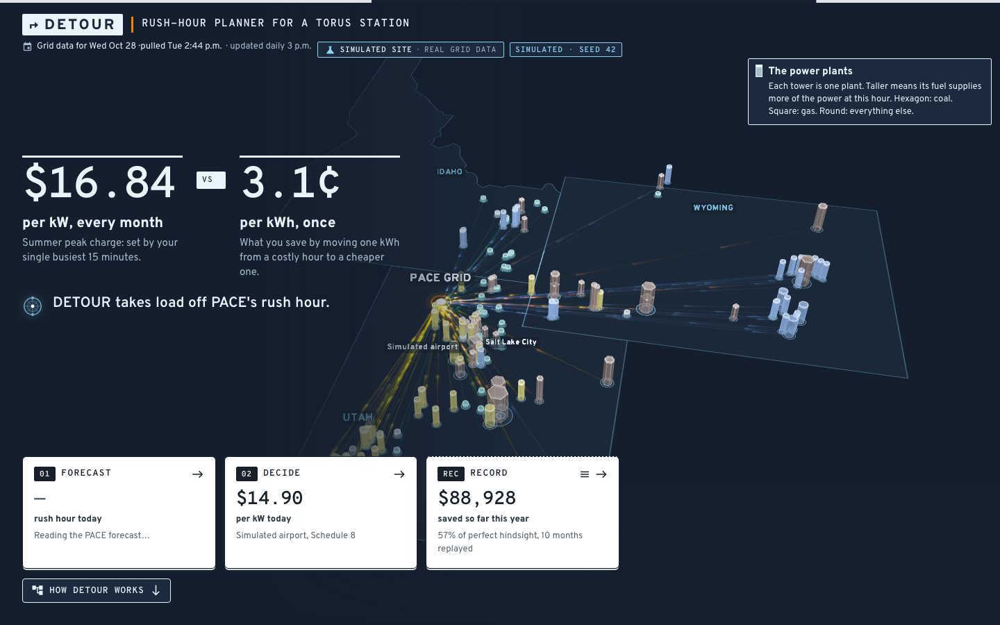
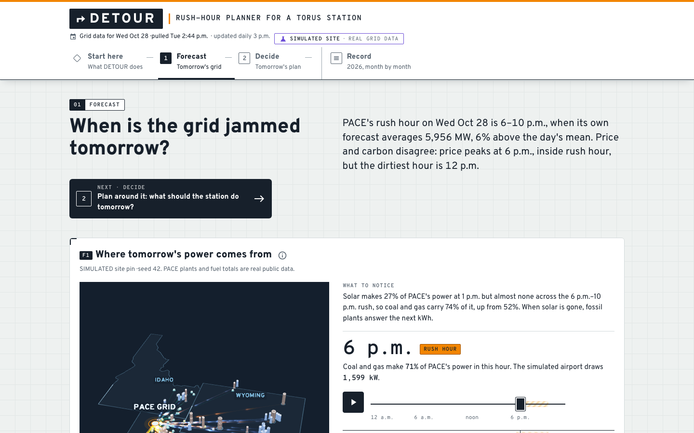
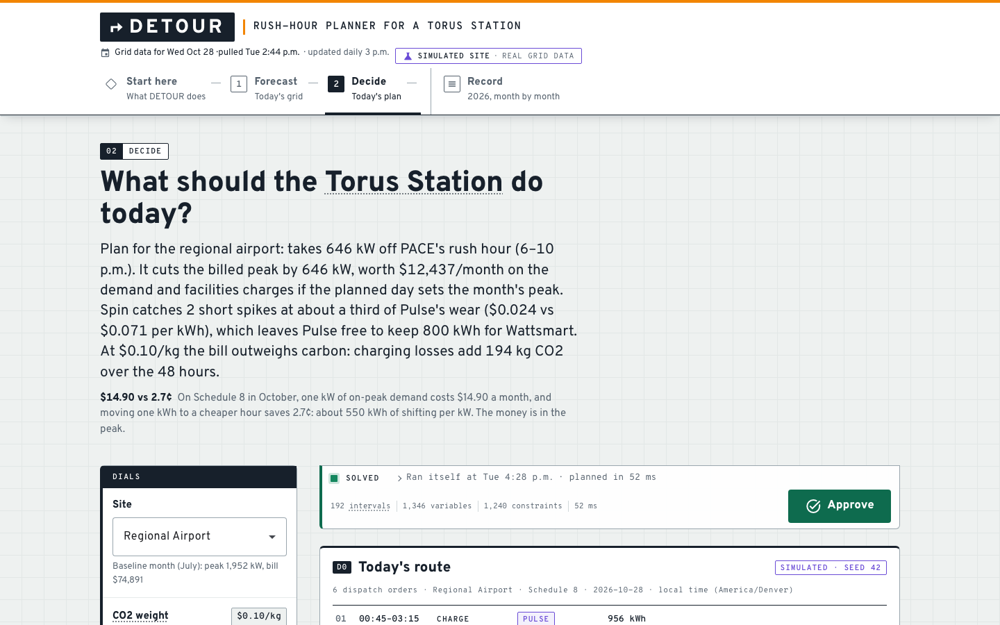
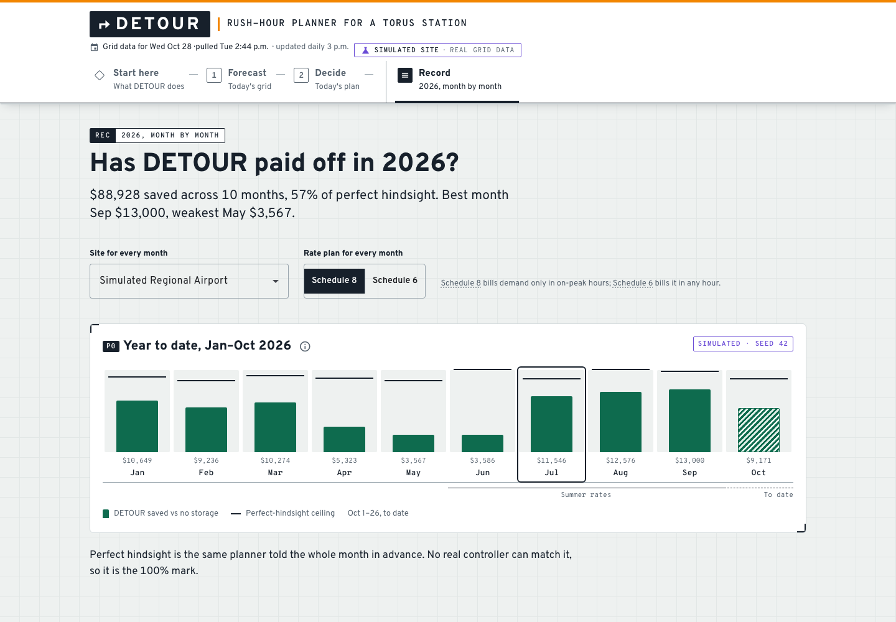
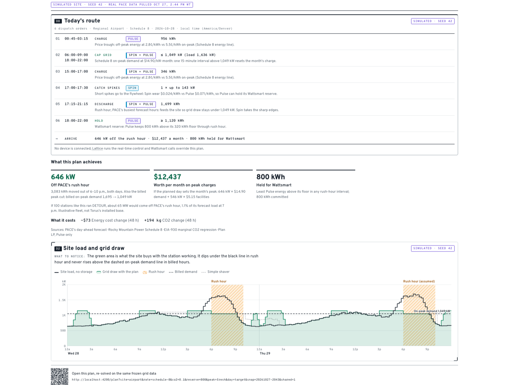
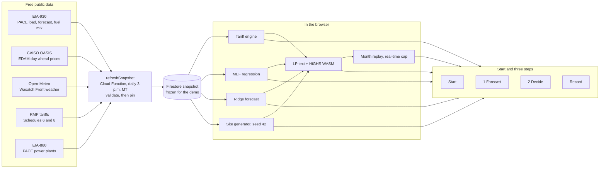

# DETOUR

**A day-ahead rush-hour planner for hybrid storage on Utah's grid.**

## Live at [detourgrid.com](https://detourgrid.com)

> Built solo by [Juan Lizarazo](https://www.linkedin.com/in/juanlizarazo/) for the **Torus bounty (Option 1: Rush Hour for Electrons)** at the Hard Tech Hackathon, Hard Tech Week 2026, Salt Lake City.

> "Build software that knows when the grid is jammed and stays out of traffic."
> — the bounty

DETOUR reads tomorrow's real Utah grid, plans a Torus Station around it, then replays the whole year to show what that plan would have earned.



## Results

On a simulated 2 MW regional airport on Rocky Mountain Power Schedule 8, replayed day by day against real 2026 PACE data:

| | |
|---|---|
| **Saved Jan 1 to Oct 26, 2026** | **$88,928** vs no storage, 57% of the perfect-hindsight ceiling |
| Best month | September, $13,000 |
| July | $11,546, 76% of perfect hindsight, 85% of it from the demand charge, 946 kWh held for Wattsmart |
| Grid relief, planning day | **646 kW off PACE's rush hour** (the simple shaver takes 95 kW), 3,083 kWh moved out of 6–10 p.m. |
| Tomorrow's plan | 192 fifteen-minute steps, 1,346 variables, 1,240 constraints, solved in the browser in about 50 ms |

The site load and Torus asset parameters are simulated (seed 42, reproducible anywhere). The grid data, prices and tariffs are real. Perfect hindsight is the same planner told the whole month in advance; no real controller can match it, so it is the 100% mark.

## The problem

The grid has a rush hour: demand spikes, prices jump, solar fades. A Torus site (a Nova Spin flywheel plus a Nova Pulse battery, behind the meter at a Utah business) lives on three clocks that disagree:

- **The bill.** One 15-minute spike sets the whole month's demand charge. On Rocky Mountain Power Schedule 8, a kW of summer on-peak demand costs $16.84/month, while shifting a kWh off-peak earns about 3.1¢.
- **The grid.** Since PacifiCorp joined CAISO's day-ahead market on May 1, 2026, tomorrow's Utah (PACE) prices are public before the day starts, and they go negative at midday.
- **The carbon.** What matters for shifting load is marginal emissions, not the average, and the two rank hours differently.

On top of that, a Wattsmart demand-response call can drain the battery right before the customer's own peak.

## What DETOUR does

1. **Traffic report.** Reads tomorrow's PACE grid conditions: load forecast, day-ahead prices, marginal CO2 by hour.
2. **Plan.** Solves an LP in 15-minute steps that decides when the site's flywheel and battery charge and discharge. It takes load off PACE's rush hour, cuts the customer's bill, avoids dirty hours and keeps a reserve for Wattsmart. The result reads as a route: timed dispatch orders ending in an Arrive line, shareable as a link or a PDF plan sheet.
3. **Proof.** Replays every month of 2026 against no storage, a naive peak-shaver and a perfect-hindsight optimum, and reports how much of the possible savings it captured.

| 1 Forecast | 2 Decide | Record |
|---|---|---|
|  |  |  |

**The plan sheet** (Share → Download PDF): the route with its Arrive line, kW off PACE's rush hour, and the site load against the simple shaver.



## How the plan is decided

One linear program over the next 48 hours in 15-minute steps, built as LP text and solved with HiGHS WebAssembly on the device. It minimizes:

| Term | What it prices |
|------|----------------|
| Demand charge | The month's billed peak kW (on-peak only on Schedule 8, any hour on Schedule 6), floored at the peak already set this month |
| Facilities charge | The month's peak kW in any hour |
| Energy charge | Rocky Mountain Power's retail energy rates by hour |
| Carbon | Marginal CO2 per kWh times the CO2 weight dial |
| Wear | A per-kWh throughput cost for each machine: Spin about a third of Pulse |

Subject to each machine's power ratings and charge windows, charging losses, Spin's idle losses, Pulse ramp limits, ending the 48 hours no emptier than it started, and a **Wattsmart reserve**: a Pulse-only minimum charge held through rush hour for a possible grid call.

Two design choices carry the result:

- **Peak first.** One kW of summer on-peak demand costs $16.84 a month; moving one kWh saves about 3.1¢. Cutting a kW is worth moving about 550 kWh, so the plan protects the peak and lets energy arbitrage fill in around it.
- **Two machines, two jobs.** Spin takes short spikes at low wear, which leaves Pulse free to hold the reserve and carry the longer blocks.

The EDAM day-ahead price is a planning signal only. The site is billed on the published retail tariff, because that is what the customer actually pays.

## Demo flow

1. **Start here** (`/start`). "$16.84 vs 3.1¢": one kW of summer on-peak demand costs as much as shifting about 550 kWh. Below it, the three-clocks strip shows the planning day's bill, price and carbon by hour, with rush hour in orange stripes. Hover any dotted word for a definition.
2. **1 Forecast · tomorrow's grid** (`/traffic`). Opens on a flow map at the rush hour: every PACE plant streams into one schematic grid node and on to the simulated airport, with load, price and CO2 on one hour cursor (Play, drag or arrow keys; "Flow" pauses the animation). Below it: when the grid is jammed, whether price and carbon agree, how our forecast scores against PACE's own, and why marginal and average CO2 rank the hours differently. Open an ⓘ for a how-to-read panel.
3. **2 Decide · tomorrow's plan** (`/plan`). Pick a site, then move the CO2 weight and Wattsmart reserve dials, or switch Schedule 8/6. Decide plans tomorrow only. The LP re-solves in the browser in milliseconds and each figure shows its change from the last solve. The plan leads with kW off PACE's rush hour, with an illustrative 100-station fleet line under the figures; the site-load chart shows the simple shaver as a dashed line for comparison. The solver rail's run log ("Ran itself at 3 p.m.") lists the daily batch steps behind the plan. "Tomorrow's route" turns the solve into timed dispatch orders ending in an Arrive line; Approve stamps them "queued for Lattice" (simulated, no device connected). Share copies a link that re-solves the same plan on the same frozen data, downloads a PDF plan sheet with a QR code, or exports the 15-minute CSV. The LP text is under "Under the hood".
4. **Record · 2026, month by month** (`/backtest`). Not a step: the record of the plan over the year. Leads with the year ledger (saved to date, share of perfect hindsight, best month), then any month replayed day by day: DETOUR against no storage, a simple shaver and perfect hindsight.
5. **Architecture** (back on `/start`, "How DETOUR works"). The pipeline below, drawn in the app.

Every screen ends with a "Next stop" link, so the demo walks Start → 1 Forecast → 2 Decide → Record → back to tomorrow.

## Bounty checklist

| From the bounty card | Where it is |
|---|---|
| How would you manage the grid's congestion? | 2 Decide leads with kW off PACE's rush hour (646 kW at the demo site vs 95 kW for a simple shaver), plus an illustrative fleet line in MW and % of PACE's load |
| Knows when the grid is jammed | 1 Forecast finds tomorrow's PACE rush hour from load, price and marginal CO2 |
| Stays out of traffic | 2 Decide plans the station's charge and discharge around it |
| A traffic report for tomorrow's grid | 1 Forecast, refreshed daily at 3 p.m. after the day-ahead market posts |
| A navigation app for electricity | "Tomorrow's route": timed dispatch orders ending in an Arrive line, plus a "Next stop" on every screen |
| Agents that schedule around clean power | DETOUR runs itself daily at 3 p.m. (run log on 2 Decide); marginal CO2 is in the objective; orders are approved and queued for Lattice |
| A complete solution | Share link and PDF plan sheet so the plan leaves the screen |
| Free and open-source data only | EIA-930, EIA-860, CAISO OASIS, Open-Meteo, published RMP tariffs |
| Simulated data is fine if labeled | Every simulated figure carries a "Simulated · seed 42" badge |
| Execution | Live site, daily Cloud Function with validate-then-pin, LP solving in the browser, year-long replay |

## Hackathon shortcuts

| In the demo | In production |
|---|---|
| Simulated site load (airport, cement plant, ski resort archetypes) | The customer's real 15-minute interval data |
| Assumed Nova Spin and Nova Pulse parameters | Torus-validated operating limits |
| Approve stamps orders "queued for Lattice", no device connected | Orders handed to Lattice's real-time controller |
| Published demand, facilities and energy rates, riders left out | The full tariff sheet, riders included |
| Snapshot pinned for judging | The daily refresh it already runs, unpinned |

## Docs

- [One-page demo script](docs/demo-script.md)
- [Judge Q&A answer sheet](docs/qa.md)

## Architecture



No upstream API is called while the app is in use: every screen reads the pinned snapshot and does its maths on the device.

## Data refresh and pin

`refreshSnapshot`, a scheduled Cloud Function, pulls fresh grid data every day at 3 p.m. Mountain, after OASIS posts the next day's day-ahead market. It always writes a new snapshot, but the app only switches to it once it passes validation: a newer target day, every hour of that day with a forecast and a price, and no empty or truncated pulls. The last five good snapshots are kept as fallbacks.

```bash
yarn --cwd functions snapshot:status         # what the app is serving, plus the last run
yarn --cwd functions snapshot:pin [id]       # freeze the demo on a known-good snapshot
yarn --cwd functions snapshot:unpin          # follow the daily refresh again
yarn --cwd functions snapshot:promote <id>   # serve a specific snapshot
yarn --cwd functions snapshot:rollback       # back to the previous good snapshot
yarn --cwd functions ingest [--dry-run]      # run the same ingest by hand
```

Demo day: let the 3 p.m. refresh run, check `snapshot:status` shows the new snapshot, then `snapshot:pin` it so nothing changes during judging.

## Maintenance mode

`maintenance/` holds a one-page "Back soon" site (noindex, no-store) that replaces every route on the live domain.

```bash
yarn --cwd app maintenance:on    # serve the Back soon page
yarn --cwd app maintenance:off   # build and deploy the app again
firebase hosting:channel:deploy judges --expires 7d   # private preview of the app while live is in maintenance
```

## Run locally

```bash
yarn --cwd app install && yarn --cwd app start   # http://localhost:4200
yarn --cwd functions install && yarn --cwd functions build
firebase deploy --only functions                  # needs the Blaze plan and the EIA_API_KEY secret
```

## Data

Free and public: EIA-930 (PACE demand, forecast, fuel mix), CAISO OASIS (PACE day-ahead prices), Open-Meteo (weather and solar), Rocky Mountain Power Utah tariffs.

**Site load profiles and Torus asset parameters are simulated and labeled as such.** No real Torus customer data is used.

## Stack

Angular 21+ · Angular Material · SCSS + Tailwind · Firebase Cloud Functions · Firestore · highs-js (LP solver)

## Repo

| Path | What |
|------|------|
| `brief/` | Bounty card and working brief |
| `research/` | Domain research behind the design |
| `plans/` | Build plan and per-phase plans |
| `rules/`, `prompts/`, `AGENTS.md` | Agent rules and prompts |

Built from my [hackathon starter kit](https://github.com/juanlizarazo/hackathon-starter-kit).
