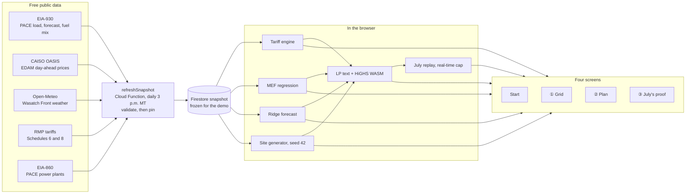

# DETOUR

**A day-ahead rush-hour planner for hybrid storage on Utah's grid.**

Built solo for the Torus bounty (Option 1: Rush Hour for Electrons) at the Hard Tech Hackathon, Hard Tech Week 2026, Salt Lake City.

## The problem

The grid has a rush hour: demand spikes, prices jump, solar fades. A Torus site (a Nova Spin flywheel plus a Nova Pulse battery, behind the meter at a Utah business) lives on three clocks that disagree:

- **The bill.** One 15-minute spike sets the whole month's demand charge. On Rocky Mountain Power Schedule 8, a kW of summer on-peak demand costs $16.84/month, while shifting a kWh off-peak earns about 3.1¢.
- **The grid.** Since PacifiCorp joined CAISO's day-ahead market on May 1, 2026, tomorrow's Utah (PACE) prices are public before the day starts, and they go negative at midday.
- **The carbon.** What matters for shifting load is marginal emissions, not the average, and the two rank hours differently.

On top of that, a Wattsmart demand-response call can drain the battery right before the customer's own peak.

## What DETOUR does

1. **Traffic report.** Reads tomorrow's PACE grid conditions: load forecast, day-ahead prices, marginal CO2 by hour.
2. **Plan.** Solves an LP in 15-minute steps that decides when the site's flywheel and battery charge and discharge. It cuts the customer's bill, avoids dirty hours and keeps a reserve for Wattsmart.
3. **Proof.** Backtests a month against a naive peak-shaver and a perfect-foresight optimum, and reports how much of the possible savings it captured.

## Demo flow

1. **Start here** (`/start`). "$16.84 vs 3.1¢": one kW of summer on-peak demand costs as much as shifting about 550 kWh. Below it, the three-clocks strip shows the planning day's bill, price and carbon by hour, with rush hour in orange stripes. Hover any dotted word for a definition.
2. **① The grid** (`/traffic`). When the grid is jammed, whether price and carbon agree, how our forecast scores against PACE's own, and why marginal and average CO2 rank the hours differently. Open an ⓘ for a how-to-read panel.
3. **② The plan** (`/plan`). Pick a site, then use a "Try this" chip or move the CO2 weight and Wattsmart reserve dials, or switch Schedule 8/6. The LP re-solves in the browser in milliseconds and each figure shows its change from the last solve. The LP text is under "Under the hood".
4. **③ July's proof** (`/backtest`). July replayed day by day: DETOUR against no storage, a simple shaver and perfect hindsight, with the capture rate.
5. **Architecture** (back on `/start`, "How DETOUR works"). The pipeline below, drawn in the app.

Every screen ends with a "Next stop" link, so the demo walks Start → ① → ② → ③ → back to Start.

## Architecture



No upstream API is called while the app is in use: every screen reads the pinned snapshot and does its maths on the device.

## Data refresh and pin

`refreshSnapshot`, a scheduled Cloud Function, pulls fresh grid data every day at 3 p.m. Mountain, after OASIS posts the next day's day-ahead market. It always writes a new snapshot, but the app only switches to it once it passes validation: a newer target day, every hour of that day with a forecast and a price, and no empty or truncated pulls. The last five good snapshots are kept as fallbacks.

```bash
yarn --cwd functions snapshot:status         # what the app is serving, plus the last run
yarn --cwd functions snapshot:pin [id]       # freeze the demo on a known-good snapshot
yarn --cwd functions snapshot:unpin          # follow the daily refresh again
yarn --cwd functions snapshot:promote <id>   # serve a specific snapshot
yarn --cwd functions snapshot:rollback       # back to the previous good snapshot
yarn --cwd functions ingest [--dry-run]      # run the same ingest by hand
```

Demo day: let the 3 p.m. refresh run, check `snapshot:status` shows the new snapshot, then `snapshot:pin` it so nothing changes during judging.

## Run locally

```bash
yarn --cwd app install && yarn --cwd app start   # http://localhost:4200
yarn --cwd functions install && yarn --cwd functions build
firebase deploy --only functions                  # needs the Blaze plan and the EIA_API_KEY secret
```

## Data

Free and public: EIA-930 (PACE demand, forecast, fuel mix), CAISO OASIS (PACE day-ahead prices), Open-Meteo (weather and solar), Rocky Mountain Power Utah tariffs.

**Site load profiles and Torus asset parameters are simulated and labeled as such.** No real Torus customer data is used.

## Stack

Angular 21+ · Angular Material · SCSS + Tailwind · Firebase Cloud Functions · Firestore · highs-js (LP solver)

## Repo

| Path | What |
|------|------|
| `brief/` | Bounty card and working brief |
| `research/` | Domain research behind the design |
| `plans/` | Build plan and per-phase plans |
| `rules/`, `prompts/`, `AGENTS.md` | Agent rules and prompts |

Built from my [hackathon starter kit](https://github.com/juanlizarazo/hackathon-starter-kit).
